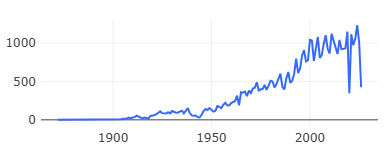
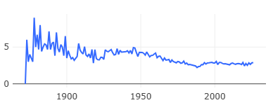
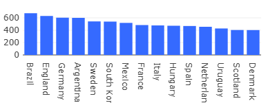
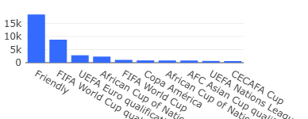

# World Cup 2026 Analytics

Аналитика исторических результатов международных футбольных матчей: воспроизводимый процесс от CSV и Python ETL до PostgreSQL, SQL-витрин и дашборда Redash.

## Посмотреть результат без установки

Проект отвечает на вопросы: как менялся объём международных матчей, какие команды лидируют по историческим победам и как различаются результаты на нейтральных и домашних полях.

Реализованы подготовка и валидация данных на Python, загрузка в PostgreSQL, три аналитические SQL-витрины и дашборд Redash с шестью запросами. В Redash используется отдельный пользователь базы с правами чтения.

Ниже — реальные графики, экспортированные из работающего локального Redash. Для просмотра этих результатов Docker не требуется.

| Матчи по годам | Среднее число голов |
| --- | --- |
|  |  |
| **Команды по числу побед** | **Турниры по числу матчей** |
|  |  |

Дашборд показывает 49 520 матчей, 201 турнир и среднее 2,94 гола за матч. В 36 364 матчах на ненейтральном поле доля побед хозяев составляет 50,75%, гостей — 26,40%. Это описание выборки, а не доказательство причинного эффекта домашнего поля. Последний год представлен только по 19 июля 2026 года, поэтому его объём не следует сравнивать с полными годами без поправки.

### Что посмотреть в коде

- [Python ETL и загрузка в базу](src/world_cup_analytics/cli.py).
- [Таблица матчей и ограничения качества](sql/ddl/001_create_matches.sql).
- [Три BI-витрины с CTE, агрегатами и оконными функциями](sql/ddl/002_create_bi_marts.sql).
- [Шесть запросов, создание визуализаций и дашборда](deploy/redash/bootstrap/provision.py).
- [SQL-проверки расчётов на контрольной выборке](tests/bi_marts_assertions.sql).
- [Воспроизводимая конфигурация Docker Compose](deploy/redash/compose.yaml).

Далее приведены данные и инструкция самостоятельного запуска. Публичный сервер не развёрнут; адрес localhost открывается только после локального запуска. Видео демонстрации пока не записано.

## Данные

49 520 матчей мужских национальных сборных за период с 30 ноября 1872 года по 19 июля 2026 года: 337 команд и 201 турнир.
Исходный источник: [martj42/international_results](https://github.com/martj42/international_results).
Подготовленный набор данных находится в `data/interim/matches_standardized.csv`.

## Запуск Redash на Windows

Запустите Docker Desktop в режиме Linux-контейнеров. В папке проекта выполните в PowerShell:

```powershell
& .\deploy\redash\start-redash.cmd
```

При первом запуске создайте учётную запись администратора на http://localhost:5000/setup и запустите скрипт повторно.
При следующих запусках сохраняются созданная учётная запись, запросы и данные в томах Docker.
Скрипт скачивает образы Redash 26.9.0, PostgreSQL 17 и Redis 7, загружает подготовленные данные,
создаёт SQL-витрины и источник данных с правами чтения, выполняет шесть SQL-запросов и создаёт дашборд.
Интерфейс доступен локально по адресу http://localhost:5000.

Локальная конфигурация создаётся в `deploy/redash/.env`. Этот файл с секретами исключён из Git.
Настройки Redash и аналитические данные хранятся в отдельных сервисах PostgreSQL и постоянных томах Docker.
Сервис с аналитическими данными называется `analytics`. Redash подключается к нему от имени `redash_reader`, которому разрешено только чтение через SELECT.

## Дашборд

- Обзор набора данных и охват по датам.
- Количество матчей и среднее число голов по годам.
- Рейтинг команд по числу побед среди сборных, сыгравших не менее 100 матчей.
- Количество матчей по турнирам.
- Доли побед хозяев, ничьих и побед гостей на нейтральных и ненейтральных полях.

Метрики описывают исторические зависимости и не доказывают причинный эффект места проведения матча.
В выборке преобладают товарищеские матчи. Сводные исторические рейтинги не отражают текущую силу команд.

## Модель данных

- `matches`: проверенные записи матчей и метаданные об источнике.
- `bi_match_facts`: одна строка на матч, результат и количество голов.
- `bi_team_year`: одна строка на команду и год; победы, ничьи, поражения, голы, доля побед и рейтинг DENSE_RANK.
- `bi_year_trends`: одна строка на год; количество матчей, голы, доля ничьих и накопительное число матчей.

В статистике команд каждый матч учитывается по одному разу для каждой участвующей сборной.
При сравнении результатов по типу поля исключаются матчи с неизвестным статусом поля; нейтральные и ненейтральные поля рассматриваются отдельно.
Исходный CSV загружается один раз при создании тома с аналитическими данными. Последующие изменения CSV автоматически не импортируются.

## Подготовка данных на Python и исследовательский анализ

```powershell
python -m venv .venv
.\.venv\Scripts\Activate.ps1
pip install -e .[dev]
wca-validate-data data/raw/results.csv
wca-profile-data data/raw/results.csv
wca-transform-data data/raw/results.csv --mapping config/column_mapping.toml --output data/interim/matches_standardized.csv
```

Чтобы использовать уже установленный PostgreSQL, заполните `.env` по образцу `.env.example` и выполните:

```powershell
wca-load-postgres data/interim/matches_standardized.csv
psql -d world_cup_analytics -f sql/ddl/002_create_bi_marts.sql
```

Исследовательский анализ находится в `notebooks/world_cup_analysis.ipynb`, аналитические SQL-запросы — в `sql/analysis`.

## Проверки

```powershell
python -m pytest -q
docker compose -f deploy/redash/compose.yaml config --quiet
```

При запуске проверяется наличие 49 520 записей и выполняются все запросы дашборда через обработчик Redash.
`tests/bi_marts_assertions.sql` проверяет детализацию витрин, долю побед, одинаковые места в рейтинге, обработку неизвестного статуса поля и накопительное число матчей. SQL-проверки запускаются в отдельной тестовой базе PostgreSQL.

## Диагностика и остановка

```powershell
docker compose -f deploy/redash/compose.yaml ps
docker compose -f deploy/redash/compose.yaml logs --tail 80 server worker analytics
docker compose -f deploy/redash/compose.yaml stop
```

Если при скачивании из Docker Hub возникает отказ в подключении к локальному прокси, проверьте настройки прокси в Docker Desktop и состояние приложения VPN или прокси.
Остановка контейнеров сохраняет данные. Удаление томов удалит сохранённые данные этого развёртывания.
